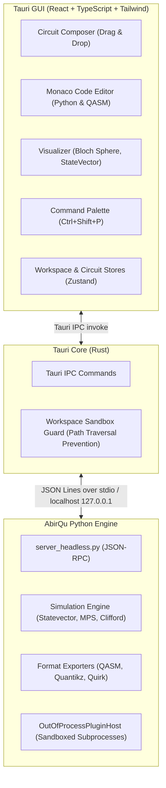

# AbirQu Studio IDE Guide & Documentation

**Author**: Abir Maheshwari <abhirsxn@gmail.com>  
**Organization**: Artificial Quantum Dyson Intelligence Pvt Ltd  

---

## 1. System Architecture

---

## 2. Keyboard Shortcuts Cheat Sheet

| Shortcut | Action | Description |
|---|---|---|
| `Ctrl+Shift+P` / `Cmd+Shift+P` | Command Palette | Open global command search across all IDE actions |
| `Ctrl+S` / `Cmd+S` | Save File | Save current workspace file / circuit snapshot |
| `Ctrl+O` / `Cmd+O` | Open Project | Open a quantum project folder in workspace |
| `Ctrl+Z` / `Cmd+Z` | Undo | Undo last circuit gate placement or code edit |
| `Ctrl+Y` / `Cmd+Shift+Z` | Redo | Redo last undone action |
| `Ctrl+Enter` / `Cmd+Enter` | Run Circuit | Execute current circuit with default simulator |
| `Ctrl+B` / `Cmd+B` | Toggle Sidebar | Collapse or expand tool panel navigation |
| `Esc` | Close Modal | Dismiss command palette, dialogs, or popovers |

---

## 3. 5-Minute Quickstart Video Script

### **[0:00 - 0:45] Intro & Launching AbirQu Studio**
- **Visual**: App opens instantly in under 1 second displaying dark-themed quantum workspace.
- **Narrator**: "Welcome to AbirQu Studio, the premier open-source quantum development environment. Built with Tauri and powered by the high-performance AbirQu Python kernel, AbirQu Studio combines visual circuit synthesis with industrial-grade code editing."

### **[0:45 - 1:45] The Visual Circuit Composer**
- **Visual**: User drags an $H$ gate onto qubit 0, followed by a CNOT gate entangling qubit 0 and qubit 1.
- **Narrator**: "In the central composer, you can drag and drop gates directly onto multi-qubit wires. As we place a Hadamard gate on qubit 0 and entangle it with a CNOT on qubit 1, the circuit updates live across both visual and code representations with zero lag."

### **[1:45 - 2:45] Two-Way Code Sync & Monaco Editor**
- **Visual**: Switch to Python Editor tab. The code `c.h(0); c.cx(0, 1)` is already generated. User adds `c.rz(0, 3.14159/4)`. Visual composer immediately reflects the $R_z$ gate.
- **Narrator**: "Two-way synchronization keeps your visual circuit and code in lockstep. Notice full autocomplete and hover documentation inside Monaco, including parameter tooltips and syntax validation."

### **[2:45 - 3:45] Simulation, Bloch Spheres & Step-Through Debugger**
- **Visual**: Click 'Step Through Debugger'. The step cursor moves past the $H$ gate: qubit 0's Bloch vector points along $+X$. Cursor steps past CNOT: entanglement metric spikes to maximum Bell state purity, and the statevector histogram shows exactly 50% $|00\rangle$ and 50% $|11\rangle$.
- **Narrator**: "With our step-through debugger, you inspect density matrices, single-qubit reduced Bloch spheres, and entanglement purity at every stage."

### **[3:45 - 5:00] Exporting & Packaging**
- **Visual**: Click 'Export' -> 'LaTeX Quantikz'. A publication-ready Quantikz snippet is copied to clipboard. Then show the Providers panel with hardware mock validation and out-of-process sandboxed plugins.
- **Narrator**: "Finally, export your circuit directly to LaTeX Quantikz for papers, or send it to remote QPUs with verified hardware backends. That's AbirQu Studio—engineered for speed, rigor, and discovery."

